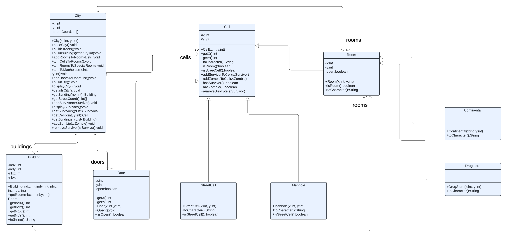
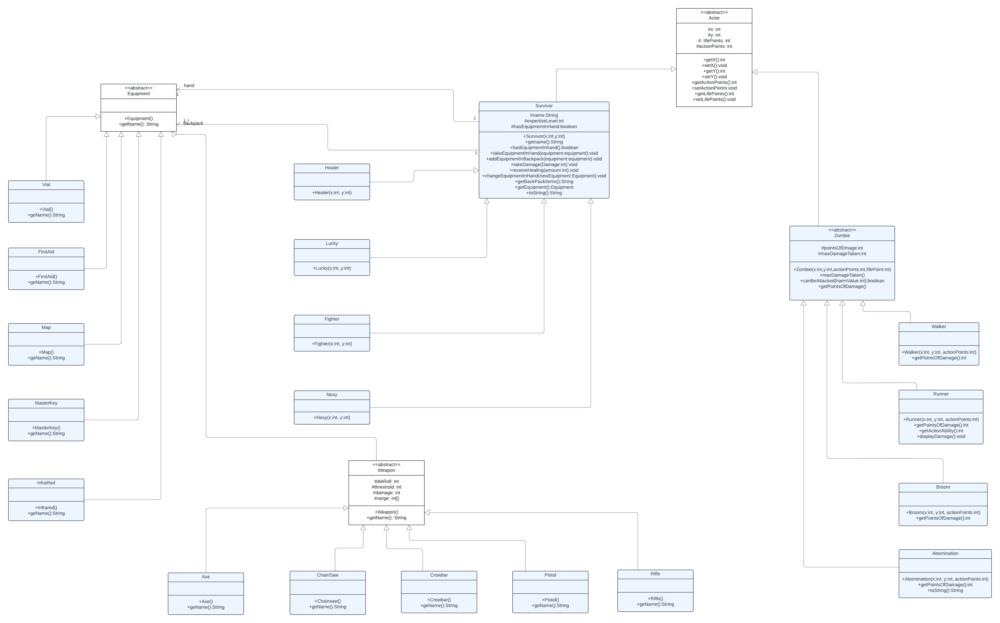
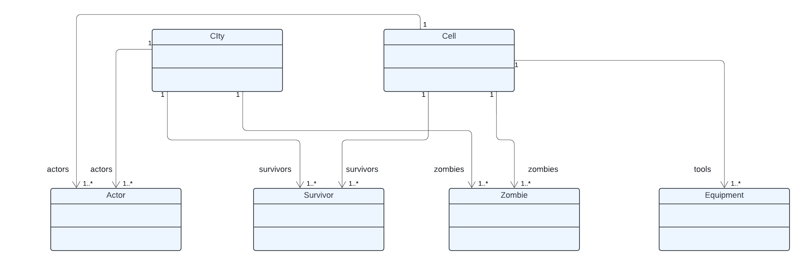
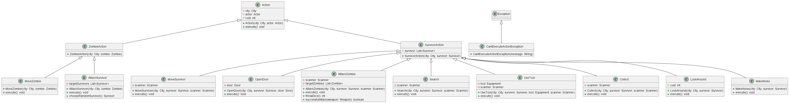
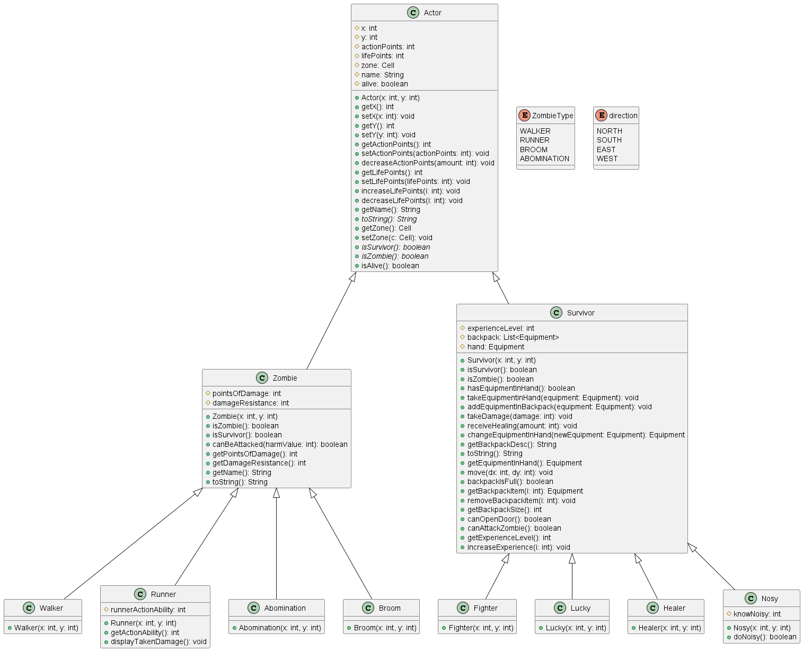
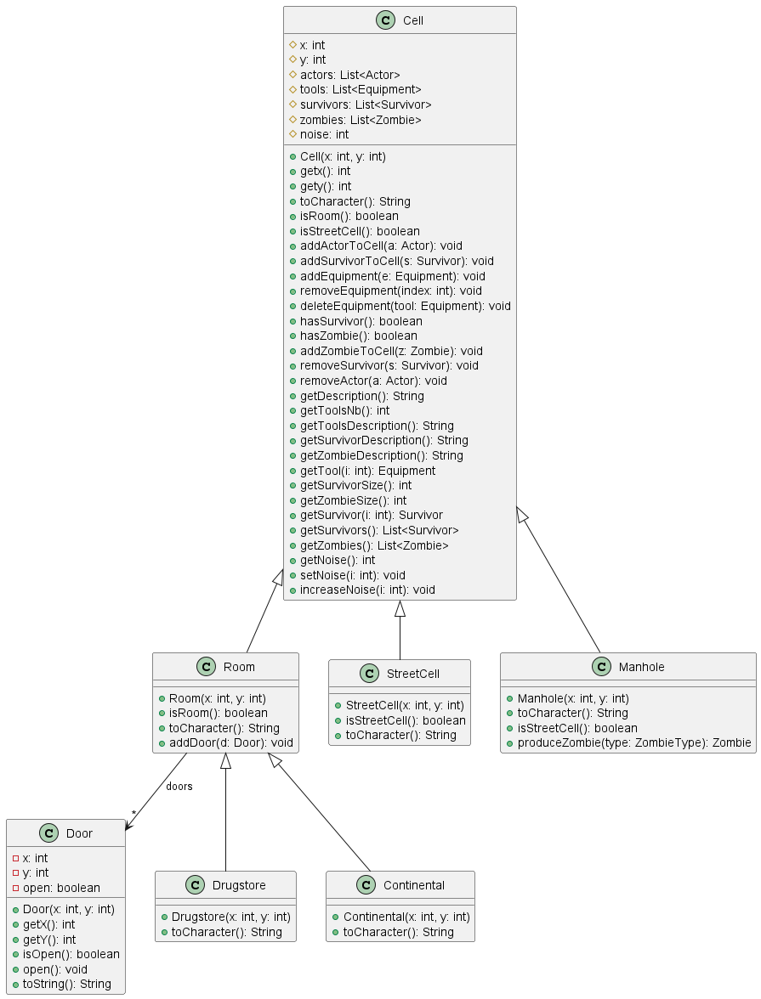
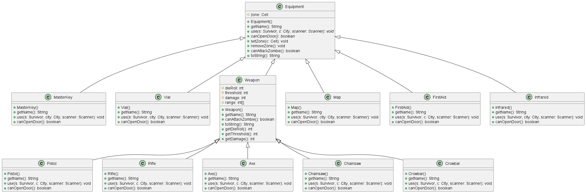
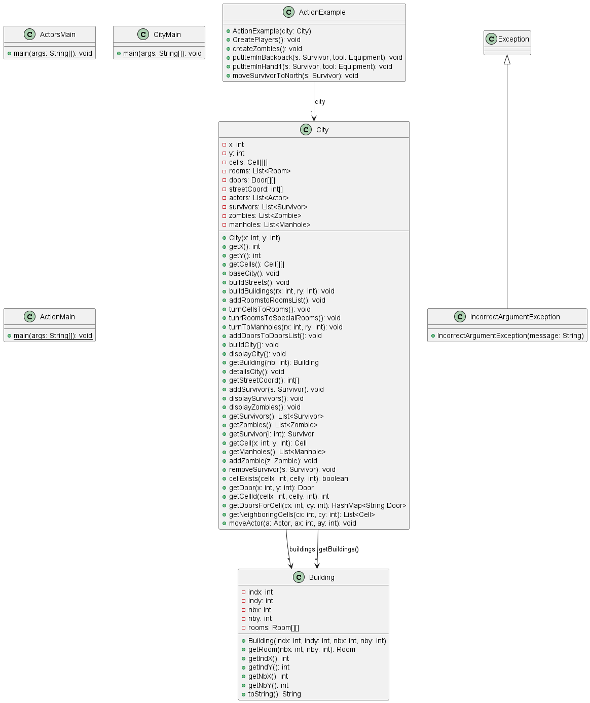

# l2s4-projet-2024
## Attention: Le package Actors ne s'ouvre pas avec eclipse ,projet il faut l'ouvrir avec un autre IDE
Vous devez *forker* ce projet dans votre espace de travail Gitlab (bouton `Fork`) et vidéo sur le [portail](https://www.fil.univ-lille.fr/portail/index.php?dipl=L&sem=S4&ue=Projet&label=Documents)
Un unique fork doit être réalisé par équipe.

Une fois cela réalisé, supprimer ces premières lignes et remplissez les noms des membres de votre équipe.
N'oubliez pas d'ajouter les autres membres de votre équipe aux membres du projet, ainsi que votre enseignant·e (statut Maintainer).

# Equipe

- SALEH Mahamat Saleh
- Nomintuul BATBAATAR
- Gamal Daoud YOUSSOUF
- Amanda Leita IGIRANEZA

# Sujet

[Le sujet 2024](https://www.fil.univ-lille.fr/~varre/portail/l2s4-projet/sujet2024.pdf)

# Livrables

## Livrable 1

### Atteinte des objectifs
**Choix de modélisation**

Pour le projet, nous avons identifié trois principales classes : City (Ville), Building (Bâtiment) et Street (Rue). 

- La classe City représente le plateau de jeu global
- la classe Building représente les bâtiments individuels de la ville.
- La classe Street représente les rues qui séparent les bâtiments.

Ensuite, nous avons ajouté les classes suivantes :

- Cell:représente toutes les cases de City.
- Room : représente les pièces à l'intérieur de chaque bâtiment,héritant de la classe Cell.
- Manhole : représente les Bouche d'egoût, héritant de la classe Cell.
- Drugstore et Continentale : héritent de Room et représentent des types spécifiques de pièces.
- Door : une classe pour représenter les portes entre les pièces.
- Grid : une interface pour permettre à la classe Cell d'afficher son contenu.

**Etat de développement**

Actuellement, nous avons réussi à mettre en place la création aléatoire de la ville
avec ses bâtiments et ses rues.Nos tests unitaires garantissent le bon fonctionnement
du code jusqu'à présent.En ce qui concerne les prochaines étapes, nous envisageons d'explorer
des fonctionnalités plus avancées telles que la gestion des acteurs( zombies et survivants )et leurs actions.

**Commandes**
1. Générer la javadoc pour les sources et les tests :

      `javadoc -sourcepath src src/cell/*.java -d docs`
      
      `javadoc -sourcepath src src/*.java -d docs`
 
      `javadoc -sourcepath test src/*.java -d docs`
 
      `javadoc -sourcepath test src/Cell/*.java -d docs`

2. Compiler les codes sources et tests:

      `javac -sourcepath src src/*.java -d classes`

      `javac -classpath junit-console.jar:classes test/cell/*.java`
      
      `javac -classpath junit-console.jar:classes test/*.java`
	  
3. Executer les tests :	 
 
      `java -jar junit-console.jar -classpath test:classes -select-class  cell.ClassTest`
      
      `java -jar junit-console.jar -classpath test:classes -select-class  ClassTest`
4. Execution du programme (CityMain):
      
	`java -classpath classes  CityMain`
	  
5. Creation du jar executable :
      
	`jar cvfe Livrable1.jar src.CityMain -C classes .`
      
6. Exécution du fichier jar :
         
	`java -jar Livrable1.jar`
         
### Difficultés restant à résoudre
- Gestion des interactions : travailler sur la gestion des interactions entre les différents éléments de la ville, 
tels que les déplacements des joueurs à travers la ville, les interactions entre les bâtiments,
 les rues et les pièces, ainsi que la gestion des actions spécifiques des joueurs.

- Gestion des exceptions : renforcer la gestion des exceptions dans notre code pour gérer les erreurs .

## Livrable 2
## Attention: Le package Actors ne s'ouvre pas avec eclipse ,projet il faut l'ouvrir avec un autre IDE

**Choix de modélisation**
Dans ce livrable, notre travail s'est principalement concentré sur les acteurs et leurs équipements:

- Actor:Cette classe abstraite sert de modèle de base pour tous les acteurs du jeu
- Survivor:Cette classe hérite de la classe Actor et représente un survivant dans le jeu.
- Zombie: Cette classe hérite également de la classe Actor et représente un zombie dans le jeu.
- Equipment: Cette classe represente les equipments et les armes auxquels le Survivant utilise au cour
du jeu
- Vial,FirstAid,Map,MasterKey,Infrared,Weapon:Ces classes representent les equipements qu'un survivants utilisent.La class
Weapon represente les armes des survivants.
- Chainsaw,Crowbar,Pistol,Rifle:Ces classes represente les armes et héritent de la classe Weapon.
- Healer,Lucky,Nosy,Fighter:Ces classes représentent différents types de survivants dans le jeu, chacun 
  ayant des capacités spécifiques. 
- Abomination,Broom,Runner,Walker:Ces classes représentent différents types de Zombie dans le jeu, chacun 
  ayant des capacités spécifiques.

La classe City a été modifiée pour inclure les survivants et les zombies dans les cellules correspondantes de la ville.

Une nouvelle classe ActionMain a été créée pour représenter le jeu dans le terminal, facilitant ainsi l'interaction et la visualisation du jeu.

**UML**
Base de city:

Actors et equipments:

Cardinalité entre le base de city et actors et equipments

**Etat de développement**
Nous avons réussi à améliorer la visualisation du jeu sur le terminal, ce qui constitue une avancée significative. De plus, nos tests unitaires assurent la solidité du code jusqu'à présent. Pour les prochaines étapes, nous nous concentrerons sur la modélisation des actions pour permettre aux acteurs d'interagir et jouer.
**Commandes**
1. Générer la javadoc pour les sources et les tests :

      `javadoc -sourcepath src src/cell/*.java -d docs`

      `javadoc -sourcepath src src/cell/actors/*.java -d docs`

      `javadoc -sourcepath src src/cell/equipement/*.java -d docs`

      `javadoc -sourcepath src src/*.java -d docs`

      `javadoc -sourcepath test src/*.java -d docs`

      `javadoc -sourcepath test src/cell/*.java -d docs`

2. Compiler les codes sources et tests:

      `javac -sourcepath src src/*.java -d classes`

      `javac -sourcepath src src/cell/*.java -d classes`

      `javac -sourcepath src src/actors/*.java -d classes`

      `javac -sourcepath src src/equipements/*.java -d classes`

      `javac -classpath junit-console.jar:classes test/cell/*.java`

      `javac -classpath junit-console.jar:classes test/*.java`

	  
3. Executer les tests :	 
 
      `java -jar junit-console.jar -classpath test:classes -select-class  cell.ClassTest`
      
      `java -jar junit-console.jar -classpath test:classes -select-class  ClassTest`
4. Execution du programme (ActionMain):
      
      `java -classpath classes  ActorsMain`
	  
5. Creation du jar executable :
      
      `jar cvfe Livrable2.jar ActorsMain -C classes .`
      
6. Exécution du fichier jar :
         
      `java -jar Livrable2.jar`

### Atteinte des objectifs
Nous avons atteint avec succès l'objectif de modifier et d'améliorer l'affichage du jeu sur le terminal. Au lieu d'utiliser des étoiles comme précédemment, nous avons réussi à mettre en place un plateau de jeu avec des cases. Cette amélioration significative de l'affichage offre une meilleure représentation visuelle de l'environnement du jeu
### Difficultés restant à résoudre
Nous devons encore modéliser les actions des acteurs et ajuster les classes en conséquence.
De plus, nous cherchons à améliorer le jeu en explorant la possibilité d'ajouter davantage de bâtiments pour améliorer le jeu.

## Livrable 3

**Choix de modélisation**

Survivor actions:

* `LookAround` : Cette action affiche les informations sur la zone où se trouve le survivant. Cette action affiche les informations sur la zone où se trouve le survivant. Ces informations incluent : les coordonnées des cellules, la liste des survivants, la liste des zombies, le niveau de bruit, la liste des portes et si elles sont ouvertes.
* `Search` :  Celui-ci affiche la liste des outils dans la pièce et demande au survivant s'il souhaite prendre un outil, quel outil prendre et si son sac à dos est plein, quel outil souhaite-t-il jeter.
Si le survivant tente d'exécuter cette action ailleurs qu'une pièce, alors un message s'affiche indiquant qu'il n'est pas dans une pièce. S'il n'y a aucun outil dans la pièce, un message s'affiche également indiquant qu'aucun élément n'a été trouvé. Dans ces deux cas, les points d’action ne sont pas déduits.
* `Collect`: Cette action permet au survivant de sortir un outil de son sac à dos et de le mettre dans sa main. S'il a déjà un outil en main, cet outil est mis dans son sac à dos en échange. S'il n'y a aucun outil dans leur sac à dos, un message s'affiche indiquant qu'il n'y a aucun outil dans leur sac à dos.
* `UseEquipment`: Cette action permet au survivant d'utiliser des outils autres que des armes. 
* `OpenDoor`: Cette action demande au survivant quelle porte il souhaite ouvrir en fonction de l'endroit où il se trouve. Pour exécuter cette action le survivant doit avoir en main l'un de ces outils : pistolet, tronçonneuse, pied de biche, hache.
* `MakeNoise`: Cette action augmente le niveau de bruit de la zone des survivants d'un niveau.
* `MoveSurvivor`: Cette action permet au survivant de se déplacer d'une case dans la direction souhaitée. Le survivant choisit la direction dans laquelle il se déplace.
* `AttackZombie`: Cette action permet au survivant d'attaquer un zombie. Le succès de l’attaque est déterminé par le nombre de jets de dés et le seuil de l’arme en main.

Zombie actions:
* `MoveZombie`: Cette action permet au zombie de se rapprocher d'une de ses cellules voisines en fonction de celle qui présente le niveau de bruit le plus élevé. Si aucune de ses cellules voisines n'a un niveau de bruit plus élevé, le zombie reste en place.
* `AttackSurvivor`: Cette action permet au zombie d'attaquer au hasard un survivant dans sa zone.

**Etat de développement**
Nous avons pu faire les classes des actions des acteurs et rajouter plus de details sur l'affichage du jeu sur le terminal tel que les informations d'une zone ou des informations à savoir après l' execution d' une action.
**Commandes**
1. Générer la javadoc pour les sources et les tests :

      `l2-s4-projet-2024% javac -sourcepath src src/cell/*.java -d classes`

      `l2-s4-projet-2024% javac -sourcepath src src/actors/*.java -d classes`

      `l2-s4-projet-2024% javac -sourcepath src src/equipements/*.java -d classes`

      `l2-s4-projet-2024% javac -sourcepath src src/game/*.java -d classes`

      `l2-s4-projet-2024% javac -classpath junit-console.jar:classes test/cell/*.java`

      `l2-s4-projet-2024% javac -classpath junit-console.jar:classes test/actors/*.java`

      `l2-s4-projet-2024% javac -classpath junit-console.jar:classes test/*.java`

2. Compiler les codes sources et tests:

      `l2-s4-projet-2024% javadoc -sourcepath src src/cell/*.java -d classes`

      `l2-s4-projet-2024% javac -sourcepath src src/game/*.java -d classes`

      `l2-s4-projet-2024% javac -sourcepath src src/actors/*.java -d classes`

      `l2-s4-projet-2024% javac -sourcepath src src/equipements/*.java -d classes`

      `l2-s4-projet-2024% javac -classpath junit-console.jar:classes test/cell/*.java`
      
      `l2-s4-projet-2024% javac -classpath junit-console.jar:classes test/*.java`
	  
3. Executer les tests :	 
 
      `l2-s4-projet-2024% java -jar junit-console.jar -classpath test:classes -select-class  cell.ClassTest`
      
      `l2-s4-projet-2024% java -jar junit-console.jar -classpath test:classes -select-class  ClassTest`
4. Execution du programme (CityMain):
      
	`l2-s4-projet-2024% java -classpath classes  game/ActionMain`
	  
5. Creation du jar executable :
      
	`l2-s4-projet-2024% jar cvfe Livrable3.jar game.ActionMain -C classes .`
      
6. Exécution du fichier jar :
         
      `l2-s4-projet-2024% java -jar Livrable3.jar 5 5`
         
### Difficultés restant à résoudre
- Gestion des actions : travailler sur la gestion des actions  des acteurs ayant des roles specifiques , 
- Gestion des tests :Mettre au point les tests.
- Gestion des exceptions : renforcer la gestion des exceptions dans notre code pour gérer les erreurs .

### UML
Action:

Actors:

Cell:

Equipements:

Game:

### Atteinte des objectifs
Pour l'instant,les acteurs executent des actions principales tel que se deplacer ,attaquer,collecter les equipments,
utiliser les equipments,faire du bruit,regarder autour de la zone,ouvrir une porte.

## Livrable 4

### Atteinte des objectifs

### Difficultés restant à résoudre

# Journal de bord

## Semaine 1
Nous avons commencé à concevoir l'UML pour répresenter notre jeu.Nous avons créé les classes de base telles que City,Building,Street 
mais nous avons rencontré des difficultés pour déterminer les relations de cardinalité entre elles.

## Semaine 2
Cette fois nous avons pu avancé dans la conceptions de notre UML.
Nous avons reussi à incorporer les cardinalités manquantes dans notre modéles.
## Semaine 3
Nous avons commencé à coder et ajouté des classes jugées necessaires,
telles que Cell pour representer les cases du jeux.
Nous avons rencontré des difficultés pour déterminer les héritages entre les classes.
Après analyse, nous avons établi une hiérarchie cohérente.
## Semaine 4
La semaine a été consacrée à la généralisation du programme. Nous avons permis à la ville d'avoir des tailles aléatoires.
la classe City représentant le plateau de jeu avait une taille fixe de 5 par 5. Nous avons ensuite modifié le programme pour permettre à la longueur
et à la largeur de la ville d'être des valeurs aléatoires, ce qui rend notre simulation plus flexible et réaliste.
Nous avons également ajouté des tests, documenté le code.
## Semaine 5
 Cette semaine,notre travail a consisté à modéliser différents types d' acteurs 
 ,leurs équipements et leurs rôles spécifiques dans le cadre du jeu.
## Semaine 6
La semaine a été consacrée à la modelisation des classes Actors,Survivor,Zombie en mettant comme methodes des actions 
qui preparent les acteurs.
## Semaine 7
Modification de certaines méthodes dans tous les classes pour faire compiler et executer correctement
le ActorMain.
## Semaine 8
Modification de l'UML et de certaines classes.
## Semaine 9
Modelisation des Actions des acteurs
## Semaine 10

## Semaine 11

## Semaine 12
